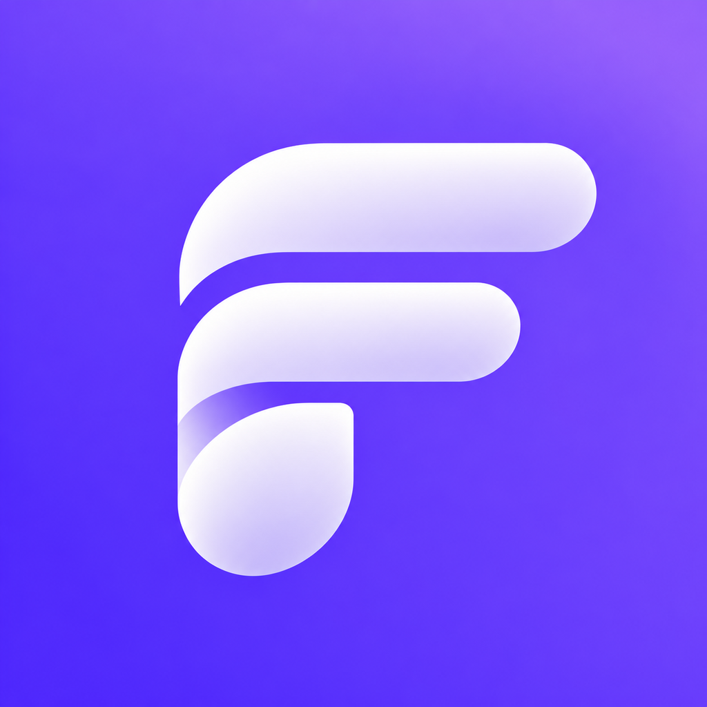

# FinFit

The iOS client for the Peaks **Financial Health Check**: a server-driven questionnaire that ends in a score
and a category. Built with SwiftUI on a modular, Clean Architecture codebase.

## How to run

1. Open `FinFit.xcodeproj` in **Xcode 26** or later.
2. Select the `FinFit` scheme and an iPhone simulator running iOS 26.
3. Run (⌘R). Swift Package Manager resolves Factory on the first build.

Tests: ⌘U.

## What's built

The whole flow, against the live API:

| Screen | Does |
|---|---|
| Intro | Starts a health check, or offers to continue the unfinished one |
| Continue session | Shown when the user has an unfinished health check. They can continue it from the question they left off at, or discard it and start a new one |
| Questionnaire | Shows the server's questions one at a time (single choice, multiple choice and number) with validation, progress, transitions and error recovery. Asks before leaving a session in progress |
| Result | Shows the result of the questionnaire: the user's financial health score and what it means |

Each screen's behaviour is specified in `HealthCheck/Docs/`, and every shared package has a spec in its own `Docs/`.

## Where I focused

- **Planning**\
  Every feature was written up as a Jira epic and split into tasks with a clear scope, so the work was
  planned up front and implementation could focus on building one well-defined piece at a time.
- **Foundation**\
  The module structure, architecture and design system were set up before any screen, so every
  screen after them was built the same way, on the same building blocks.
- **UI and UX**\
  I focused on creating a smooth, intuitive experience where animations serve a purpose rather than just adding
  visual flair. Transitions guide users through the questionnaire, while the animated score reveal builds
  anticipation and makes the final result feel rewarding. I also paid attention to navigation and session recovery,
  ensuring users can pick up where they left off without unnecessary interruptions like alert popups.
- **Tests**\
  Building a highly modular architecture with testing in mind: every dependency sits behind a protocol, so each
  layer can be swapped for a mock and tested on its own.

## Architecture

I chose Clean Architecture for two reasons:

- **Separation of concerns**\
  Each layer has one job, so when building a feature it is always clear what goes where.
- **Testability**\
  Each layer can be unit tested on its own, against mocks of the layer below.

The code is organised in three layers. Data starts in the data layer, passes through the domain layer, and is
converted into the presentation layer's models that views use. Each layer has its own models.

| Layer | Holds |
|---|---|
| Presentation | View and Presenter |
| Domain | Use case and Repository |
| Data | Data source and Client |

For the Questionnaire screen:

```
QuestionnaireView → QuestionnairePresenter → QuestionnaireUseCase → QuestionnaireRepository
                                           ↘ SessionStore             → QuestionnaireDataSource
                                                                       → QuestionnaireNetworkClient
                                                                       → BaseNetworkClient
```

The code is split into local Swift packages:

| Package | Holds | Depends on |
|---|---|---|
| `Core` | `UserDefaultsService`, small Foundation helpers | None |
| `CoreUI` | The design system: palette, typography, spacing, radii, layout helpers and components (`ActionButton`, `TextInput`, `SingleSelectGroup`, `MultiSelectGroup`, `ProgressBar`, `ViewState`) | None |
| `Networking` | `BaseNetworkClient` over `URLSession`, `Endpoint`, `APIError` | None |
| `HealthCheck` | The whole health-check flow: the Intro, Continue session, Questionnaire and Result screens, the questionnaire data stack, the session store and the module's routing protocol | `Core`, `CoreUI`, `Networking` |

### Key decisions

- **Modules with a strict dependency direction**\
  Features never import each other and lower modules never import
  higher ones. It keeps the design system reusable and the feature deletable, and makes build boundaries match
  ownership boundaries.
- **Views never see domain models**\
  Presenters build each view's `Model` from plain values and get `Action`s back, so
  views are passive and presenters are unit-testable without SwiftUI.
- **Centralized navigation**\
  One router in the app target owns the navigation stack. Each module declares its own
  route destinations, and the router conforms to them, so modules never navigate or know about each other.
- **Dependency injection with Factory**\
  Every dependency is passed in through the initializer behind a protocol, so
  each layer can be tested in isolation against fakes and swapped without touching its neighbours. Every module
  keeps its registrations in its own `Module+Factory.swift`, so there is always one place to look to see what a module
  provides, and removing a module takes its registrations with it.
- **Design system first**\
  Every color, text style, spacing and radius from Figma is a token in `CoreUI`, and the
  components are built on them. Feature code never uses raw colors or magic numbers.
- **Swift 6 strict concurrency**\
  Presenters and the router are `@MainActor`; everything below is `Sendable`.

### Surviving a force quit

The server already keeps the session; the client only has to remember the **session id**. `SessionStore` saves it in
`UserDefaults` (through Core's `UserDefaultsService`) once the server has accepted the first answer, and removes it
when the session completes or the user discards it on leaving. On the next launch, Start sees the saved id and
offers **Continue** or **Start over**; continuing posts the same id and the server returns the current question.

## Assumptions and trade-offs

- **No going back to an answered question**\
  The API only accepts an answer to the current question, so back leaves the questionnaire for the Intro screen.
  Once the user has answered a question, back first asks them to confirm: **Save and leave** keeps the session so
  it can be continued, **Discard and leave** removes it, and **Cancel** keeps them on the question. Before the
  first answer there's nothing to lose, so back leaves without asking.
- **A session starts with the first answer**\
  The session is only saved once the user answers the first question. A user who taps Start and goes straight back
  probably tapped it by mistake. When they later tap Start for real, they want a fresh health check, not a Continue
  session screen asking about the one they opened by accident.
- **Every question needs an answer**\
  Even one the server marks as not required. The API has no way to send "no
  answer" for a question, so skipping isn't possible without guessing at the server's behaviour.
- **Score categories are fixed in the app**\
  The server decides the category, but the app knows the four categories and their titles and subtitles. A new
  category from the backend would fail to decode until the app is updated and released again. Ideally the server
  would send the title and subtitle with the result, so the backend could change categories without an app release.
- **Validation follows the backend, with open defaults**\
  The app validates answers with the rules the backend sends: selection limits for multiple choice, a minimum and
  maximum for numbers. Every rule is optional in the API, so when one is missing the app doesn't invent a limit:
  any number of options can be checked, and a number without a minimum or maximum accepts any value on that side.
- **Simple error handling**\
  Whether the user is offline, the server returns an error, or something unexpected happens, they always see the
  same error screen with two options: Try again or Start a new session. There's no need to show technical error
  messages that users can't act on. Starting a new session only removes the previous one after the server
  successfully creates a new one, so no progress is lost if something goes wrong.
- **No accessibility support yet**\
  Text uses fixed sizes, and the custom components have no VoiceOver support. This is the biggest gap, since the
  European Accessibility Act requires it (see below).

## Testing

Every module with logic (`Core`, `Networking`, `HealthCheck` and the app target) has its own unit tests, written with
Swift Testing. `CoreUI` only holds design tokens and views, so it has none.

## What I would do next

In order of value to the user:

1. **Accessibility**: VoiceOver labels and traits on the custom components, and Dynamic Type for the text styles.
   The EU requires it, and it's the biggest gap for real users. Most of the work is in the design system rather
   than the feature.
2. **Better error handling**: tell failures apart and recover where possible: watch the connection with
   `NWPathMonitor` and retry automatically when it returns, instead of waiting for Try again.
3. **More animation and clearer states**: the flow works, but it could feel better. More animation through the
   flow, and some screens should say more about what is happening.
4. **Haptic feedback** when a retry fails, so the unchanged error screen doesn't read as nothing happening.
5. **UI tests** for the happy path and resume-after-force-quit, against a stubbed server.

## Libraries

**[Factory](https://github.com/hmlongco/Factory) 3.5.1** is the only dependency. It gives compile-time-checked,
per-module registrations with little ceremony, works with `@Observable` presenters through `@InjectedObservable`, and
supports `promised()` registrations, which is exactly what a feature module needs for a router it can't see.
Everything else (networking, persistence, the design system) is plain Foundation and SwiftUI; none of it needed a
library.

## Tools and workflow

- **Claude Code**: writing and reviewing code
- **Jira**: planning and tracking work
- **Figma**: the design system and screens

Every feature was planned in Jira as an epic and split into tasks. Each epic has a feature branch off `develop`.
Each task is built on its own branch off the epic's branch and merged back into it through its own pull request;
once the epic is done, its branch is merged into `develop`. Claude Code worked to the rules checked into this
repository: `CLAUDE.md` is the entry point, and `.claude/rules/` holds the code style, architecture, project
structure and workflow.

| | Example |
|---|---|
| Epic branch | `feat/OFN-100-questionnaire` |
| Task branch | `feat/OFN-123-questionnaire-number-input` |
| Commit | `feat(HealthCheck)[OFN-123]: Added number input to the questionnaire` |

## Time spent

About 10-12 hours, spread over two days (29-30 October 2026).
