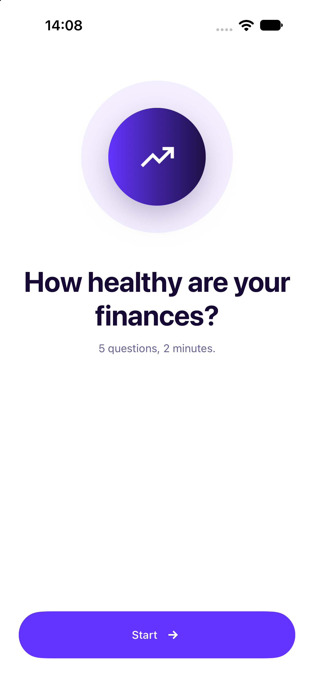
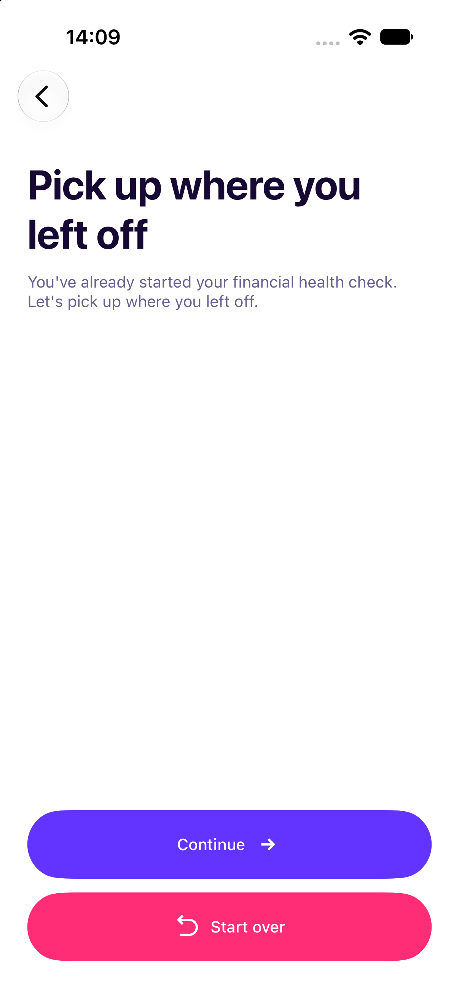
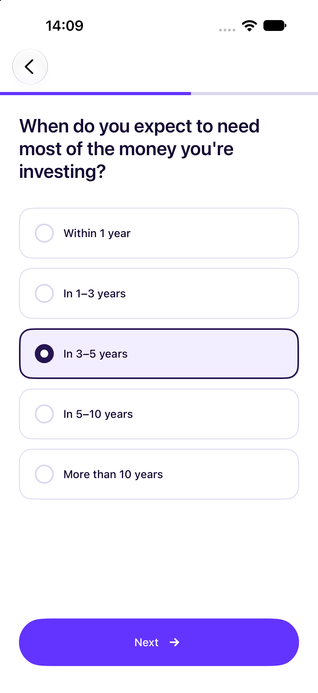
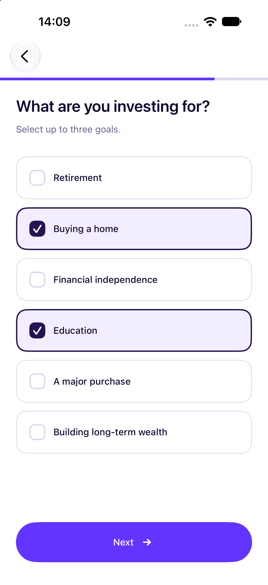
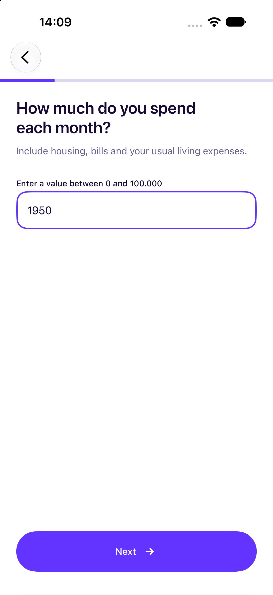
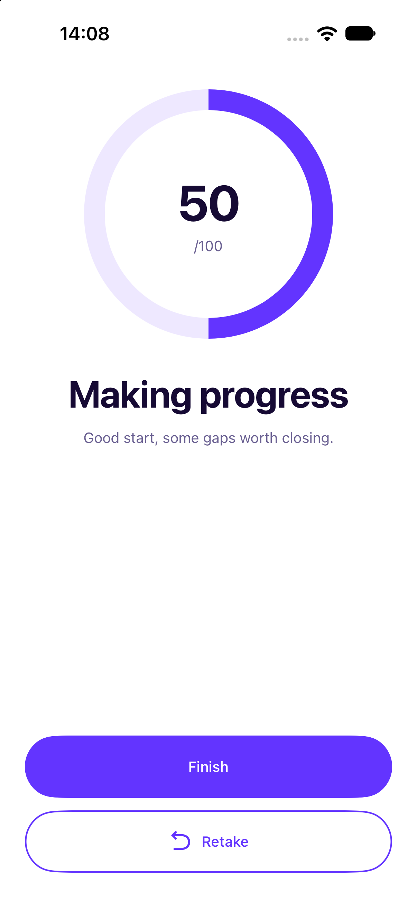

# FinFit

The iOS client for the Peaks **Financial Health Check**: a server-driven questionnaire that ends in a score
and a category. Built with SwiftUI on a modular, Clean Architecture codebase.

## How to run

1. Open `FinFit.xcodeproj` in **Xcode 26** or later.
2. Select the `FinFit` scheme and an iPhone simulator running iOS 26.
3. Run (⌘R). Swift Package Manager resolves Factory on the first build.

Tests: ⌘U.

## What's built

The whole flow, against the live API:

| Screen | Does |
|---|---|
| Intro | Starts a health check, or offers to continue the unfinished one |
| Continue session | Shown when the user has an unfinished health check. They can continue it from the question they left off at, or discard it and start a new one |
| Questionnaire | Shows the server's questions one at a time (single choice, multiple choice and number) with validation, progress, transitions and error recovery. Asks before leaving a session in progress |
| Result | Shows the result of the questionnaire: the user's financial health score and what it means |

<table>
  <tr>
    <td align="center" width="33%"><br>Intro</td>
    <td align="center" width="33%"><br>Continue session</td>
    <td align="center" width="33%"><br>Questionnaire: single choice</td>
  </tr>
</table>

<table>
  <tr>
    <td align="center" width="33%"><br>Questionnaire: multiple choice</td>
    <td align="center" width="33%"><br>Questionnaire: number</td>
    <td align="center" width="33%"><br>Result</td>
  </tr>
</table>

## Where I focused

- **Planning**\
  Features were organized into Jira epics and smaller tasks with clear scopes, making implementation easier to manage.
- **Foundation**\
  The architecture, modules and design system were established before building screens to ensure consistency across
  the app.
- **UI and UX**\
  I focused on making the app intuitive, with purposeful animations, smooth navigation and session recovery. The
  animated score reveal also builds anticipation and makes the final result more rewarding.
- **Tests**\
  Dependencies are defined through protocols, allowing each layer to be mocked and tested independently.

## Architecture

I chose Clean Architecture for two reasons:

- **Separation of concerns**\
  Each layer has one job, so when building a feature it is always clear what goes where.
- **Testability**\
  Each layer can be unit tested on its own, against mocks of the layer below.

The code is organized into three layers, each with its own responsibilities and models.

| Layer | Holds |
|---|---|
| Presentation | View and Presenter |
| Domain | Use case and Repository |
| Data | Data source and Client |

For the Questionnaire screen:

```
QuestionnaireView → QuestionnairePresenter → QuestionnaireUseCase → QuestionnaireRepository
                                           ↘ SessionStore             → QuestionnaireDataSource
                                                                       → QuestionnaireNetworkClient
                                                                       → BaseNetworkClient
```

The code is split into local Swift packages:

| Package | Holds | Depends on |
|---|---|---|
| `Core` | `UserDefaultsService`, small Foundation helpers | None |
| `CoreUI` | The design system: palette, typography, spacing, radii, layout helpers and components (`ActionButton`, `TextInput`, `SingleSelectGroup`, `MultiSelectGroup`, `ProgressBar`, `ViewState`) | None |
| `Networking` | `BaseNetworkClient` over `URLSession`, `Endpoint`, `APIError` | None |
| `HealthCheck` | The whole health-check flow: the Intro, Continue session, Questionnaire and Result screens, the questionnaire data stack, the session store and the module's routing protocol | `Core`, `CoreUI`, `Networking` |

### Key decisions

- **Strict module dependencies**\
  Features never import each other, and lower-level modules never depend on higher-level ones. This keeps modules
  independent, reusable and easy to remove.
- **Views never see domain models**\
  Presenters convert data into view-specific `Model`s and handle `Action`s, keeping views passive and presenters
  testable without SwiftUI.
- **Centralized navigation**\
  A single router in the app target manages navigation. Modules declare their destinations without knowing about
  each other.
- **Dependency injection with Factory**\
  Dependencies are injected through protocols, making them easy to replace or mock. Each module manages its
  registrations in `Module+Factory.swift`.
- **Design system first**\
  Colors, typography, spacing and radii are defined as tokens in `CoreUI`. Features use these tokens instead of
  hardcoded values.
- **Swift 6 strict concurrency**

### Surviving a force quit

The server manages sessions, so the app only needs to persist the session ID. `SessionStore` saves it in
`UserDefaults` after the first successful answer and removes it when the session is completed or discarded.

Users can continue their session whenever they return to the questionnaire, whether they leave the app, close it, or
navigate away. Continuing sends the saved ID to the server, which returns the question user stopped at.

## Assumptions and trade-offs

- **No going back to an answered question**\
  The API only accepts an answer to the current question, so back leaves the questionnaire for the Intro screen.
  Once the user has answered a question, back first asks them to confirm: **Save and leave** keeps the session so
  it can be continued, **Discard and leave** removes it, and **Cancel** keeps them on the question. Before the
  first answer there's nothing to lose, so back leaves without asking.
- **A session starts with the first answer**\
  The session is only saved once the user answers the first question. A user who taps Start and goes straight back
  probably tapped it by mistake. When they later tap Start for real, they want a fresh health check, not a Continue
  session screen asking about the one they opened by accident.
- **Every question needs an answer**\
  Even one the server marks as not required. The API has no way to send "no
  answer" for a question, so skipping isn't possible without guessing at the server's behaviour.
- **Score categories are fixed in the app**\
  The server decides the category, but the app knows the four categories and their titles and subtitles. A new
  category from the backend would fail to decode until the app is updated and released again. Ideally the server
  would send the title and subtitle with the result, so the backend could change categories without an app release.
- **Validation follows the backend, with open defaults**\
  The app validates answers with the rules the backend sends: selection limits for multiple choice, a minimum and
  maximum for numbers. Every rule is optional in the API, so when one is missing the app doesn't invent a limit:
  any number of options can be checked, and a number without a minimum or maximum accepts any value on that side.
- **Simple error handling**\
  Whether the user is offline, the server returns an error, or something unexpected happens, they always see the
  same error screen with two options: Try again or Start a new session. There's no need to show technical error
  messages that users can't act on. Starting a new session only removes the previous one after the server
  successfully creates a new one, so no progress is lost if something goes wrong.
- **No accessibility support yet**\
  Text uses fixed sizes, and the custom components have no VoiceOver support. This is the biggest gap, since the
  European Accessibility Act requires it (see below).

## Testing

Every module with logic (`Core`, `Networking`, `HealthCheck` and the app target) has its own unit tests, written with
Swift Testing. `CoreUI` only holds design tokens and views, so it has none.

## What I would do next

In order of value to the user:

1. **Accessibility**: VoiceOver labels and traits on the custom components, and Dynamic Type for the text styles.
   The EU requires it, and it's the biggest gap for real users. Most of the work is in the design system rather
   than the feature.
2. **Going back to change an answer**: keep the answers the user has given and let them step back to an answered
   question, see their answer and change it. Today the API only accepts an answer to the current question, so this
   needs it to accept a changed answer to an earlier one.
3. **Better error handling**: tell failures apart and recover where possible: watch the connection with
   `NWPathMonitor` and retry automatically when it returns, instead of waiting for Try again.
4. **More UI animations**: enhance the user experience with additional animations and transitions to make the app
   feel more polished and engaging.
5. **Haptic feedback** when a retry fails, so the unchanged error screen doesn't read as nothing happening.
6. **UI tests** for the happy path and resume-after-force-quit, against a stubbed server.

## Libraries

**[Factory](https://github.com/hmlongco/Factory) 3.5.1** is the only dependency. It gives compile-time-checked,
per-module registrations with little ceremony, works with `@Observable` presenters through `@InjectedObservable`, and
supports `promised()` registrations, which is exactly what a feature module needs for a router it can't see.
Everything else (networking, persistence, the design system) is plain Foundation and SwiftUI; none of it needed a
library.

## Tools and workflow

- **Claude Code**: writing and reviewing code
- **Jira**: planning and tracking work
- **Figma**: the design system and screens

Every feature was planned in Jira as an epic and split into tasks. Each epic has a feature branch off `develop`.
Each task is built on its own branch off the epic's branch and merged back into it through its own pull request;
once the epic is done, its branch is merged into `develop`. Pull requests that carry UI changes have screenshots or
screen recordings.

| | Example |
|---|---|
| Epic branch | `feat/OFN-100-questionnaire` |
| Task branch | `feat/OFN-123-questionnaire-number-input` |
| Commit | `feat(HealthCheck)[OFN-123]: Added number input to the questionnaire` |

Each module has a `Docs/` folder containing short specifications describing what it does and how it behaves.
Feature modules have one specification per screen, while other modules have a single specification. Documentation is
written alongside the code and updated in the same change to ensure it always reflects what is actually implemented.

These specifications also serve as onboarding material, allowing developers new to the project to quickly understand
its functionality without having to read through the code first.

## Time spent

About 11-13 hours, spread over three days (29-31 October 2026).
